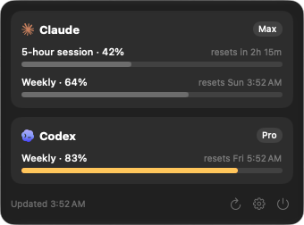
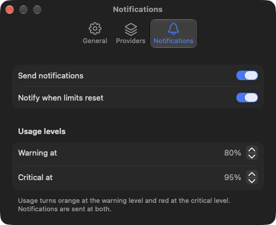

# Agenty

A small macOS menu-bar app that shows how much of your Claude, Codex and Grok subscription limits you have used (the 5-hour session, the weekly window and per-model windows) and when they reset. Grok supports usage and the Agents page, but has no Instructions or Config page.



## Features

- Menu-bar glyph in three styles (bars, a single ring, or each provider's logo with its percentage) so you can see at a glance whether a limit is close.
- Popover with every window, its percentage and its reset time, plus your plan and any credit balance.
- Main window with Usage, Instructions, Config and Agents pages, opened with the Open Agenty button in the popover. Usage shows your Claude, Codex and Grok limits side by side.
- Instructions page to edit `~/.claude/CLAUDE.md` and `~/.codex/AGENTS.md` in Markdown. Save with the Save button or Command-S; Agenty creates the file if it is missing. Changes apply to new sessions. If Codex is using `AGENTS.override.md`, the page warns that it ignores `AGENTS.md`.
- Usage turns orange and red at levels you choose, 80% and 95% by default.
- Notifications at those levels and when a limit resets.
- Launch at login and a configurable refresh interval.
- Optionally, the email of the signed-in account on each provider card (off by default).
- Updates itself, and asks before installing.
- English and Vietnamese UI.

The Config page edits your Claude and Codex user settings, including models, permissions, sandbox options and plugins. Use the controls or edit the file directly, then save with the Save button or Command-S. Agenty asks before saving risky settings from the controls and before quitting with unsaved changes. Changes apply to new sessions.

The Agents page lists your agents in `~/.claude/agents`, `~/.codex/agents` and `~/.grok/agents`, with their models and a detail page for each agent. It is read-only; Agenty never writes to these folders. The Codex tab requires the Codex CLI.

## Settings

Open Settings with the gear in the popover.



- **General:** launch at login, refresh interval, what the menu bar shows, the account email, and updates.
- **Providers:** turn Claude, Codex and Grok on or off. Grok is off by default; turn it on here to track its usage. Set the path to `codex` or `grok` if Agenty does not find it on its own.
- **Notifications:** turn notifications on or off, and set the warning and critical levels. The levels also set the usage colors, so they still apply with notifications off.

## Supported providers

| Provider | Status |
|---|---|
| Claude (Claude Code) | Supported |
| Codex (Codex CLI) | Supported |
| Grok (Grok CLI) | Supported, usage and Agents |

## Requirements

- macOS 27 on Apple Silicon (arm64 only)
- Signed in to the CLIs you want to track: `claude`, `codex` and `grok`

## Warning: unofficial APIs

Agenty relies on endpoints and methods that are not public, documented APIs: `/api/oauth/usage` and `/api/oauth/profile` (Claude), `codex app-server` (Codex), and `_x.ai/billing` through `grok agent` (Grok). They can change or break at any time without notice.

If Claude answers with a rate limit, Agenty says so in the popover and waits before asking again, even if you press Refresh.

## Privacy

- Your tokens never leave your machine, except in the requests sent to `api.anthropic.com` to read your Claude usage and your account email. The email is fetched again only when Agenty starts or Claude Code renews its token, and it is fetched even when the Settings toggle hides it.
- The app never refreshes tokens. Claude Code refreshes its own login; if it has expired, open Claude Code once.
- The app never reads `~/.codex/auth.json`. Codex is queried only through its own CLI, which manages its own credentials. The Codex account email comes from there too.
- The app never reads `~/.grok/auth.json`. Grok is queried only through its own CLI, which manages its own credentials.
- The app never sends prompts to any model.
- Credentials are only read, never written or logged.
- The update check reads `appcast.xml` from GitHub and sends no account data.

## Keychain access

Agenty reads Claude Code's login from the Keychain item "Claude Code-credentials" by running `/usr/bin/security`, the same tool Claude Code uses to save it. macOS lets `security` read the item, so no permission dialog appears: not on first run, not after an update, and not after a build from source.

Up to 0.5.0, Agenty read the item directly, and macOS asked again every few hours, because each Claude Code token refresh resets the item's access list. Update to 0.5.1 or later if you still see that dialog.

If macOS does ask and you click **Deny**, the app stops asking and shows "Keychain access denied" until you press **Retry** or relaunch the app.

If Claude Code keeps its login in `~/.claude/.credentials.json`, Agenty reads that file too.

## Install

Download `Agenty-<version>-arm64.zip` from the [Releases page](https://github.com/vuxng/agenty/releases), unzip it and move `Agenty.app` to Applications. The app is signed with a Developer ID and notarized by Apple, so it opens normally.

To check the download, put the `.sha256` file from the same release next to the zip and run:

```sh
shasum -a 256 -c Agenty-<version>-arm64.zip.sha256
```

### Updates

From 0.2.0 on, Agenty checks for a new version once a day and asks before installing it. You can turn the daily check off, or check now, in Settings › General. If you are on 0.1.x, download the latest release by hand once; later versions arrive by themselves.

## Build from source

```sh
brew install xcodegen && xcodegen generate && open Agenty.xcodeproj
```

A Debug build, which is what Run in Xcode makes, is **Agenty Dev** (`io.github.vuxng.Agenty.dev`) and shows "DEV" in the popover footer. It has its own settings, login item and permissions, so it runs alongside an installed Agenty without touching it, and it never checks for updates. Release builds keep the official identity, `io.github.vuxng.Agenty`, which updates depend on.

Run the core tests with:

```sh
swift test --package-path Packages/UsageCore
```

After changing UI strings, regenerate the String Catalog entries and add a Vietnamese (`vi`) translation, state `translated`, for every new key. Build first, then sync from the build's `.stringsdata` files:

```sh
xcrun xcstringstool sync App/Resources/Localizable.xcstrings \
  --stringsdata build/DerivedData/Build/Intermediates.noindex/Agenty.build/Debug/Agenty.build/Objects-normal/arm64/*.stringsdata
```

Build a release zip with `scripts/build-release.sh <version>`; the result is in `build/`. It is ad-hoc signed unless you set `SIGN_IDENTITY` and `TEAM_ID`, which sign it with that Developer ID. Also set `NOTARY_KEYCHAIN_PROFILE` (a `notarytool store-credentials` profile) to notarize it.

## Branches & releases

- `next` is the default branch. Open pull requests against it; they are squash-merged.
- `stable` holds released code only. Every merge into `stable` is a release.
- To release, raise `MARKETING_VERSION` in `project.yml` on `next`, open a pull request from `next` to `stable`, and merge it with a merge commit. CI then signs and notarizes the app and publishes the `vX.Y.Z` release. The `version-check` job blocks the pull request if that version is already released.
- For a hotfix, branch off `stable`, raise the patch version, and merge into `stable`. Then open a pull request from `stable` to `next` so the fix comes back.
- Maintainers set up the signing secrets once with `scripts/setup-release-secrets.sh`.
- Each release also carries `appcast.xml`, the feed the app reads from `releases/latest/download/appcast.xml`. It is signed with the Sparkle EdDSA key in the `SPARKLE_ED_PRIVATE_KEY` secret, and the release fails if that key does not match `SUPublicEDKey` in `project.yml`. Keep a copy of the key outside the Keychain. If it is lost, installed copies can no longer be updated: generate a new key, ship a release with the new `SUPublicEDKey`, and users must download that release by hand.

## License

MIT. See [LICENSE](LICENSE).

The Claude, Codex and Grok logos in `App/Assets.xcassets` are trademarks of Anthropic, OpenAI and xAI. They are not covered by the MIT license, and Agenty is not affiliated with or endorsed by any of these companies. The SVG paths come from [lobehub/lobe-icons](https://github.com/lobehub/lobe-icons) (MIT).
