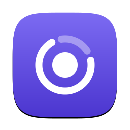

# Agenty

A small macOS menu-bar app that shows how much of your Claude and Codex subscription limits you have used (the 5-hour session, the weekly window and per-model windows) and when they reset.

<!-- screenshot: docs/images/popover.png — add after first manual run -->

## Features

- Menu-bar glyph in three styles (bars, a single ring, or each provider's logo with its percentage) so you can see at a glance whether a limit is close.
- Popover with every window, its percentage and its reset time.
- Notifications at 80% and 95% (configurable) and when a limit resets.
- Launch at login and a configurable refresh interval.
- Optionally, the email of the signed-in account on each provider card (Settings › General, off by default).
- English and Vietnamese UI.

## Supported providers

| Provider | Status |
|---|---|
| Claude (Claude Code) | Supported |
| Codex (Codex CLI) | Supported |

## Requirements

- macOS 27 on Apple Silicon (arm64 only)
- Signed in to the CLIs you want to track: `claude` and `codex`

## Warning: unofficial APIs

Agenty relies on endpoints and methods that are not public, documented APIs: `/api/oauth/usage` and `/api/oauth/profile` (Claude), and `codex app-server` (Codex). They can change or break at any time without notice.

## Privacy

- Your tokens never leave your machine, except in the requests sent to `api.anthropic.com` to read your Claude usage and your account email. The email is fetched again only when Agenty starts or Claude Code renews its token, and it is fetched even when the Settings toggle hides it.
- The app never refreshes tokens. Claude Code refreshes its own login; if it has expired, open Claude Code once.
- The app never reads `~/.codex/auth.json`. Codex is queried only through its own CLI, which manages its own credentials.
- The app never sends prompts to any model.
- Credentials are only read, never written or logged.

## First run: Keychain prompt

The first time Agenty reads Claude Code's credentials from the Keychain, macOS asks for permission. Choose **Always Allow** so it does not ask again.

"Always Allow" is remembered per app signature. Releases are all signed with the same Developer ID, so the permission carries over when you update. A build you make from source is ad-hoc signed, so macOS asks again after every rebuild. If you click **Deny**, the app stops asking and shows "Keychain access denied" in the popover until you press **Retry** or relaunch the app.

## Install

Download `Agenty-<version>-arm64.zip` from the [Releases page](https://github.com/vuxng/agenty/releases), unzip it and move `Agenty.app` to Applications. The app is signed with a Developer ID and notarized by Apple, so it opens normally.

To check the download, put the `.sha256` file from the same release next to the zip and run:

```sh
shasum -a 256 -c Agenty-<version>-arm64.zip.sha256
```

### Updates

From 0.2.0 on, Agenty checks for a new version once a day and asks before installing it. You can turn the daily check off, or check now, in Settings › Updates. If you are on 0.1.x, download 0.2.0 by hand once; later versions arrive by themselves.

## Build from source

```sh
brew install xcodegen && xcodegen generate && open Agenty.xcodeproj
```

A Debug build, which is what Run in Xcode makes, is **Agenty Dev** (`io.github.vuxng.Agenty.dev`) and shows "DEV" in the popover footer. It has its own settings, login item and permissions, so it runs alongside an installed Agenty without touching it, and it never checks for updates. Release builds keep the official identity, `io.github.vuxng.Agenty`, which updates depend on.

Run the core tests with:

```sh
swift test --package-path Packages/UsageCore
```

After changing UI strings, regenerate the String Catalog entries and add a Vietnamese (`vi`) translation, state `translated`, for every new key. Build first, then sync from the build's `.stringsdata` files:

```sh
xcrun xcstringstool sync App/Resources/Localizable.xcstrings \
  --stringsdata build/DerivedData/Build/Intermediates.noindex/Agenty.build/Debug/Agenty.build/Objects-normal/arm64/*.stringsdata
```

Build a release zip with `scripts/build-release.sh <version>`; the result is in `build/`. It is ad-hoc signed unless you set `SIGN_IDENTITY` and `TEAM_ID`, which sign it with that Developer ID. Also set `NOTARY_KEYCHAIN_PROFILE` (a `notarytool store-credentials` profile) to notarize it.

## Branches & releases

- `next` is the default branch. Open pull requests against it.
- `stable` holds released code only. Every merge into `stable` is a release.
- To release, raise `MARKETING_VERSION` in `project.yml` on `next`, open a pull request from `next` to `stable`, and merge it with a merge commit. CI then signs and notarizes the app and publishes the `vX.Y.Z` release. The `version-check` job blocks the pull request if that version is already released.
- For a hotfix, branch off `stable`, raise the patch version, and merge into `stable`. Then open a pull request from `stable` to `next` so the fix comes back.
- Maintainers set up the signing secrets once with `scripts/setup-release-secrets.sh`.
- Each release also carries `appcast.xml`, the feed the app reads from `releases/latest/download/appcast.xml`. It is signed with the Sparkle EdDSA key in the `SPARKLE_ED_PRIVATE_KEY` secret, and the release fails if that key does not match `SUPublicEDKey` in `project.yml`. Keep a copy of the key outside the Keychain. If it is lost, installed copies can no longer be updated: generate a new key, ship a release with the new `SUPublicEDKey`, and users must download that release by hand.

## License

MIT. See [LICENSE](LICENSE).

The Claude and Codex logos in `App/Assets.xcassets` are trademarks of Anthropic and OpenAI. They are not covered by the MIT license, and Agenty is not affiliated with or endorsed by either company. The SVG paths come from [lobehub/lobe-icons](https://github.com/lobehub/lobe-icons) (MIT).
